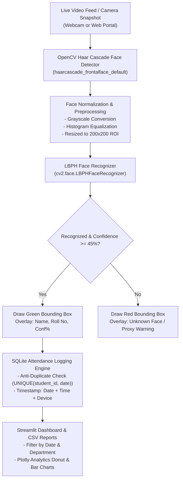

# 👁️ VisionAttend AI: Automated Vision Attendance & Face Recognition

[](https://python.org)
[](https://opencv.org)
[](https://streamlit.io)
[](https://sqlite.org)
[](https://opensource.org/licenses/MIT)
[](https://share.streamlit.io/deploy?repository=am0008474-beep/automated-vision-attendance&branch=main&mainModule=app.py)

An end-to-end Computer Vision and biometric authentication system that eliminates manual roll-calls and proxy attendance. Built using **OpenCV Haar Cascades** for face detection, **Local Binary Patterns Histograms (LBPH)** for CPU-efficient on-device facial recognition, and a localized **SQLite3** relational database with strict daily anti-duplicate constraints.

---

## 🌟 Key Highlights

* 🎯 **Haar Cascade + LBPH Face Recognition:** Lightweight, real-time face localization and feature matching with zero GPU or heavyweight external C++ compilation dependencies.
* 🛡️ **Anti-Proxy & Duplicate Prevention:** Relational database schema with strict `UNIQUE(student_id, date)` constraints prevents double-marking and proxy attendance on the same calendar day.
* ⚡ **Dual Deployment Interface:**
  * **Interactive Web Dashboard (`app.py`):** Live camera snapshot mode, student biometric registration portal, date/department filterable attendance logs, and 1-click CSV report export.
  * **Standalone Desktop Kiosk (`desktop_cam.py`):** Real-time native webcam video feed with green/red bounding boxes, student metadata HUD, and FPS display.
* 📊 **Live Visual Analytics:** Real-time Plotly charts displaying daily attendance turnout %, department-wise attendance counts, and daily trend lines.
* ⏱️ **Ultra-Fast Processing:** Sub-30ms facial detection and recognition latency on standard consumer hardware.

---

## 🏗️ System Architecture



---

## 🗄️ Database Architecture

### `students` Table
| Column | Type | Description |
| :--- | :--- | :--- |
| `id` | INTEGER (PK) | Auto-increment primary key |
| `student_id` | INTEGER (UNIQUE) | Numerical unique student identifier |
| `roll_no` | TEXT (UNIQUE) | University roll number |
| `name` | TEXT | Student full name |
| `department` | TEXT | Academic department |
| `registered_at` | TEXT | Registration timestamp |

### `attendance` Table
| Column | Type | Description |
| :--- | :--- | :--- |
| `id` | INTEGER (PK) | Auto-increment primary key |
| `student_id` | INTEGER (FK) | Reference to `students.student_id` |
| `roll_no` | TEXT | Student university roll number |
| `name` | TEXT | Student name |
| `department` | TEXT | Academic department |
| `date` | TEXT | Log date (`YYYY-MM-DD`) |
| `time` | TEXT | Log time (`HH:MM:SS`) |
| `confidence` | REAL | Facial match confidence score |
| `status` | TEXT | Attendance status (`Present`) |
| `device` | TEXT | Logging device source |
| **CONSTRAINT** | `UNIQUE(student_id, date)` | Prevents duplicate check-in on the same date |

---

## 🚀 Quickstart Guide

### 1. Clone & Setup Virtual Environment
```bash
git clone https://github.com/am0008474-beep/automated-vision-attendance.git
cd automated-vision-attendance

# Create virtual environment
python -m venv .venv

# Activate environment (Windows)
.\.venv\Scripts\activate
# Activate environment (Linux/macOS)
source .venv/bin/activate

# Install dependencies
pip install -r requirements.txt
```

### 2. Launch the Application

#### Option A: Interactive Streamlit Web Dashboard
```bash
streamlit run app.py --server.port 8503
# Or double click: run_dashboard.bat on Windows
```
Visit: `http://localhost:8503`

#### Option B: Standalone OpenCV Desktop Kiosk
```bash
python desktop_cam.py
# Or double click: run_desktop_cam.bat on Windows
```
* Press **Q** or **ESC** to exit.
* Press **R** to reload trained model.

### 3. Run Automated Tests
```bash
python -m unittest test_pipeline.py
```

---

## 📁 Repository Structure

```
automated-vision-attendance/
├── src/
│   ├── __init__.py
│   ├── database.py             # SQLite operations, student registry & logs
│   └── face_engine.py          # OpenCV Haar detector & LBPH face recognizer
├── models/
│   ├── face_trained.yml        # Serialized LBPH model weights
│   └── student_labels.json     # Student ID to label mapping
├── dataset/                    # Stored face sample images for training
├── app.py                      # Interactive Streamlit Web Dashboard
├── desktop_cam.py              # Standalone OpenCV Desktop Kiosk runner
├── test_pipeline.py            # Automated unit test suite
├── requirements.txt            # Python dependencies
├── run_dashboard.bat           # 1-click Streamlit Web launcher
├── run_desktop_cam.bat         # 1-click OpenCV desktop launcher
├── push_to_github.bat          # 1-click GitHub push helper
└── README.md                   # System documentation
```

---

## 👨‍💻 Author

**Ashish Kumar Maurya**  
* B.Tech in Computer Science & Engineering (Artificial Intelligence) — Babu Banarasi Das University, Lucknow  
* 🌐 **Portfolio:** [am0008474-beep.github.io](https://am0008474-beep.github.io)  
* 🐙 **GitHub:** [@am0008474-beep](https://github.com/am0008474-beep)  
* 💼 **LinkedIn:** [ashish-maurya-cse](https://www.linkedin.com/in/ashish-maurya-cse)  
* 📧 **Email:** `am0008474@gmail.com`  
* 📱 **Phone:** `+91 6387727879`

---

## 📄 License
This project is open-source under the [MIT License](LICENSE).
